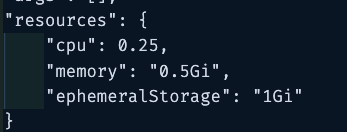

For std:
container app-
- starting image to: "mcr.microsoft.com/k8se/quickstart:latest"
- name: "name": "simple-hello-world-container",
- starting container resource:

For std-express:
container app -
- Min Replicas default to 0
- Max Replicas default to 1
"image": "mcr.microsoft.com/k8se/quickstart:express",
                    "name": "mwf-stdexp1",

For express-express:
me -
"environmentMode": "Express",
"appLogsConfiguration": {
            "destination": null,
            "logAnalyticsConfiguration": null
        },

ca -
ingress:
"transport": "Http",
"traffic": null

configuratiosn:
"maxInactiveRevisions": null,

"image": "mcr.microsoft.com/k8se/quickstart:express",
                    "name": "mwf-express1",

"scale": {
                "minReplicas": 0,
                "maxReplicas": 1,
                "cooldownPeriod": null,
                "pollingInterval": null,
                "rules": [
                    {
                        "name": "http-scaler",
                        "http": {
                            "metadata": {
                                "concurrentRequests": "10"
                            }
                        }
                    }
                ]
            },

Main open question, do we want STD to be the express std or the azure portal std?

When creating an express app in an express environment, it automatically creates express default apps and doesn't allow "std"
