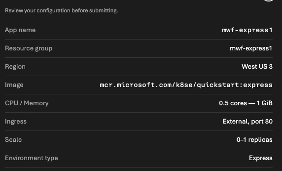

## Inputs


## ME JSON View
2026-07-01
```
{
    "id": "/subscriptions/94bebca4-4d64-4e4d-8302-7e7457a208b6/resourceGroups/mwf-express1/providers/Microsoft.App/managedEnvironments/express-westus3-dua7asg",
    "name": "express-westus3-dua7asg",
    "type": "Microsoft.App/managedEnvironments",
    "location": "West US 3",
    "systemData": {
        "createdBy": "matfisher@microsoft.com",
        "createdByType": "User",
        "createdAt": "2026-10-23T17:33:38.1572671",
        "lastModifiedBy": "matfisher@microsoft.com",
        "lastModifiedByType": "User",
        "lastModifiedAt": "2026-10-23T17:33:38.1572671"
    },
    "properties": {
        "environmentMode": "Express",
        "provisioningState": "Succeeded",
        "daprAIInstrumentationKey": null,
        "daprAIConnectionString": null,
        "vnetConfiguration": null,
        "defaultDomain": "purpleflower-7518c8f0.westus3.azurecontainerapps.io",
        "appLogsConfiguration": {
            "destination": null,
            "logAnalyticsConfiguration": null
        },
        "openTelemetryConfiguration": null,
        "zoneRedundant": false,
        "kedaConfiguration": {
            "version": null
        },
        "daprConfiguration": {
            "version": null
        },
        "ingressConfiguration": null,
        "eventStreamEndpoint": "https://westus3.azurecontainerapps.dev/subscriptions/94bebca4-4d64-4e4d-8302-7e7457a208b6/resourceGroups/mwf-express1/managedEnvironments/express-westus3-dua7asg/eventstream",
        "customDomainConfiguration": {
            "customDomainVerificationId": "089B2C0383F8B78AA9A10F2CBAAFF5E2520FE76B01AA536ED6F2B6E2443CBC29",
            "dnsSuffix": null,
            "certificateKeyVaultProperties": null,
            "certificateValue": null,
            "certificatePassword": null,
            "thumbprint": null,
            "subjectName": null,
            "expirationDate": null
        },
        "workloadProfiles": [
            {
                "workloadProfileType": "Consumption",
                "name": "Consumption",
                "enableFips": false
            }
        ],
        "appInsightsConfiguration": null,
        "infrastructureResourceGroup": null,
        "peerAuthentication": {
            "mtls": {
                "enabled": false
            }
        },
        "peerTrafficConfiguration": {
            "encryption": {
                "enabled": false
            }
        },
        "publicNetworkAccess": "Enabled"
    }
}
```

## CA JSON View
2026-07-01
```
{
    "id": "/subscriptions/94bebca4-4d64-4e4d-8302-7e7457a208b6/resourceGroups/mwf-express1/providers/Microsoft.App/containerapps/mwf-express1",
    "name": "mwf-express1",
    "type": "Microsoft.App/containerApps",
    "location": "West US 3",
    "systemData": {
        "createdBy": "matfisher@microsoft.com",
        "createdByType": "User",
        "createdAt": "2026-10-23T17:34:55.2484574",
        "lastModifiedBy": "matfisher@microsoft.com",
        "lastModifiedByType": "User",
        "lastModifiedAt": "2026-10-23T17:34:55.2484574"
    },
    "properties": {
        "provisioningState": "Succeeded",
        "runningStatus": "Running",
        "managedEnvironmentId": "/subscriptions/94bebca4-4d64-4e4d-8302-7e7457a208b6/resourceGroups/mwf-express1/providers/Microsoft.App/managedEnvironments/express-westus3-dua7asg",
        "environmentId": "/subscriptions/94bebca4-4d64-4e4d-8302-7e7457a208b6/resourceGroups/mwf-express1/providers/Microsoft.App/managedEnvironments/express-westus3-dua7asg",
        "workloadProfileName": "Consumption",
        "outboundIpAddresses": null,
        "latestRevisionName": "mwf-express1--latest",
        "latestRevisionFqdn": "mwf-express1.purpleflower-7518c8f0.westus3.azurecontainerapps.io",
        "customDomainVerificationId": "089B2C0383F8B78AA9A10F2CBAAFF5E2520FE76B01AA536ED6F2B6E2443CBC29",
        "configuration": {
            "secrets": null,
            "activeRevisionsMode": "Single",
            "ingress": {
                "fqdn": "mwf-express1.purpleflower-7518c8f0.westus3.azurecontainerapps.io",
                "external": true,
                "targetPort": 80,
                "exposedPort": null,
                "transport": "Http",
                "traffic": null,
                "customDomains": null,
                "allowInsecure": false,
                "ipSecurityRestrictions": null,
                "corsPolicy": null,
                "clientCertificateMode": null,
                "stickySessions": null,
                "additionalPortMappings": null
            },
            "registries": null,
            "dapr": null,
            "runtime": null,
            "maxInactiveRevisions": null,
            "service": null,
            "identitySettings": []
        },
        "template": {
            "revisionSuffix": null,
            "terminationGracePeriodSeconds": null,
            "containers": [
                {
                    "image": "mcr.microsoft.com/k8se/quickstart:express",
                    "name": "mwf-express1",
                    "resources": {
                        "cpu": 0.5,
                        "memory": "1Gi",
                        "ephemeralStorage": "2Gi"
                    }
                }
            ],
            "initContainers": null,
            "scale": {
                "minReplicas": 0,
                "maxReplicas": 1,
                "cooldownPeriod": null,
                "pollingInterval": null,
                "rules": [
                    {
                        "name": "http-scaler",
                        "http": {
                            "metadata": {
                                "concurrentRequests": "10"
                            }
                        }
                    }
                ]
            },
            "volumes": null,
            "serviceBinds": null
        },
        "networking": null
    }
}
```
