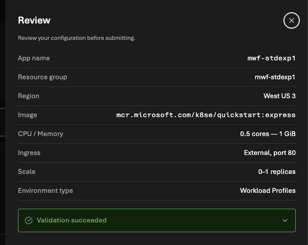

## Inputs



## ME JSON View
2026-07-01
```
{
    "id": "/subscriptions/94bebca4-4d64-4e4d-8302-7e7457a208b6/resourceGroups/mwf-stdexp1/providers/Microsoft.App/managedEnvironments/managed-westus3-4u9o4ug",
    "name": "managed-westus3-4u9o4ug",
    "type": "Microsoft.App/managedEnvironments",
    "location": "West US 3",
    "systemData": {
        "createdBy": "matfisher@microsoft.com",
        "createdByType": "User",
        "createdAt": "2026-10-23T17:36:12.3498951",
        "lastModifiedBy": "matfisher@microsoft.com",
        "lastModifiedByType": "User",
        "lastModifiedAt": "2026-10-23T17:36:12.3498951"
    },
    "properties": {
        "environmentMode": "WorkloadProfiles",
        "provisioningState": "Succeeded",
        "daprAIInstrumentationKey": null,
        "daprAIConnectionString": null,
        "vnetConfiguration": null,
        "defaultDomain": "purplesmoke-daf87e61.westus3.azurecontainerapps.io",
        "staticIp": "4.242.206.73",
        "appLogsConfiguration": {
            "destination": null,
            "logAnalyticsConfiguration": null
        },
        "openTelemetryConfiguration": null,
        "zoneRedundant": false,
        "kedaConfiguration": {
            "version": "2.20.2"
        },
        "daprConfiguration": {
            "version": "1.16.4-msft.13"
        },
        "ingressConfiguration": null,
        "eventStreamEndpoint": "https://westus3.azurecontainerapps.dev/subscriptions/94bebca4-4d64-4e4d-8302-7e7457a208b6/resourceGroups/mwf-stdexp1/managedEnvironments/managed-westus3-4u9o4ug/eventstream",
        "customDomainConfiguration": {
            "customDomainVerificationId": "089B2C0383F8B78AA9A10F2CBAAFF5E2520FE76B01AA536ED6F2B6E2443CBC29",
            "dnsSuffix": null,
            "certificateKeyVaultProperties": null,
            "certificateValue": null,
            "certificatePassword": null,
            "thumbprint": null,
            "subjectName": null,
            "expirationDate": null
        },
        "workloadProfiles": [
            {
                "workloadProfileType": "Consumption",
                "name": "Consumption",
                "enableFips": false
            }
        ],
        "appInsightsConfiguration": null,
        "infrastructureResourceGroup": null,
        "peerAuthentication": {
            "mtls": {
                "enabled": false
            }
        },
        "peerTrafficConfiguration": {
            "encryption": {
                "enabled": false
            }
        },
        "publicNetworkAccess": "Enabled"
    }
}
```

## CA JSON View
2026-07-01
```
{
    "id": "/subscriptions/94bebca4-4d64-4e4d-8302-7e7457a208b6/resourceGroups/mwf-stdexp1/providers/Microsoft.App/containerapps/mwf-stdexp1",
    "name": "mwf-stdexp1",
    "type": "Microsoft.App/containerApps",
    "location": "West US 3",
    "systemData": {
        "createdBy": "matfisher@microsoft.com",
        "createdByType": "User",
        "createdAt": "2026-10-23T18:00:00.9814337",
        "lastModifiedBy": "matfisher@microsoft.com",
        "lastModifiedByType": "User",
        "lastModifiedAt": "2026-10-23T18:00:00.9814337"
    },
    "properties": {
        "provisioningState": "Succeeded",
        "runningStatus": "Running",
        "managedEnvironmentId": "/subscriptions/94bebca4-4d64-4e4d-8302-7e7457a208b6/resourceGroups/mwf-stdexp1/providers/Microsoft.App/managedEnvironments/managed-westus3-4u9o4ug",
        "environmentId": "/subscriptions/94bebca4-4d64-4e4d-8302-7e7457a208b6/resourceGroups/mwf-stdexp1/providers/Microsoft.App/managedEnvironments/managed-westus3-4u9o4ug",
        "workloadProfileName": "Consumption",
        "outboundIpAddresses": [
            "20.125.76.124",
            "20.125.74.58",
            "20.118.180.220",
            "20.125.72.245",
            "4.236.29.28",
            "4.236.28.230",
            "4.236.28.126",
            "4.236.29.23",
            "4.236.28.206",
            "4.236.29.43",
            "20.14.119.70",
            "135.234.107.40",
            "135.234.118.135",
            "20.14.118.252",
            "4.236.1.136",
            "134.33.25.140",
            "20.14.66.96",
            "134.33.8.60",
            "20.171.203.222",
            "20.14.36.89",
            "20.150.255.247",
            "135.234.57.229",
            "4.227.26.117",
            "135.234.57.184",
            "134.33.29.28",
            "134.33.13.26",
            "135.234.57.185",
            "20.106.113.235",
            "20.150.255.246",
            "4.227.35.224",
            "20.171.205.76",
            "20.14.32.62",
            "134.33.12.230",
            "135.234.56.142",
            "20.125.67.33",
            "20.125.69.152",
            "4.227.26.140",
            "4.227.40.234",
            "135.234.57.236",
            "20.25.168.115",
            "134.33.12.156",
            "20.14.0.159",
            "135.234.56.178",
            "135.234.82.154",
            "135.234.57.227",
            "135.234.85.139",
            "135.234.56.143",
            "134.33.10.88",
            "4.227.42.218",
            "4.227.25.94",
            "20.106.119.7",
            "20.125.70.236",
            "135.234.57.237",
            "4.227.26.24",
            "4.227.25.66",
            "135.234.56.179",
            "134.33.9.225",
            "20.14.38.176",
            "4.227.43.159",
            "134.33.30.78",
            "134.33.25.23",
            "20.14.112.189",
            "4.236.31.57",
            "134.33.30.121",
            "20.14.32.63",
            "20.14.36.53",
            "134.33.31.137",
            "20.14.35.60",
            "20.171.203.223",
            "134.33.29.111",
            "4.227.26.72",
            "20.25.168.87",
            "20.150.251.124",
            "4.227.36.172",
            "4.227.30.80",
            "134.33.29.43",
            "4.227.27.148",
            "20.150.251.125",
            "4.227.28.135",
            "20.150.253.71",
            "20.118.146.180",
            "20.118.148.199",
            "20.118.144.32",
            "20.118.146.221",
            "4.227.76.26",
            "4.227.76.45",
            "4.227.76.46",
            "4.227.76.20",
            "4.227.76.51",
            "4.227.76.18",
            "4.227.58.38",
            "134.33.25.222",
            "4.236.8.251",
            "4.236.39.174",
            "20.14.40.97",
            "4.236.61.216",
            "20.125.75.87",
            "20.14.115.60",
            "4.149.49.40",
            "20.118.152.204",
            "20.14.16.172",
            "134.33.15.10",
            "51.57.119.195",
            "20.14.18.201",
            "134.33.15.35",
            "20.14.117.141",
            "20.14.118.111",
            "134.33.15.172",
            "20.14.18.181",
            "20.14.18.216",
            "20.14.119.56",
            "51.57.118.243",
            "20.14.62.62",
            "51.57.117.40",
            "134.33.15.34",
            "135.234.86.10",
            "135.234.82.155",
            "134.33.14.147",
            "20.150.155.57",
            "134.33.15.133",
            "4.227.41.173",
            "20.14.119.233",
            "4.227.34.162",
            "135.234.86.4",
            "134.33.15.11",
            "134.33.14.169",
            "134.33.14.159",
            "134.33.14.54",
            "20.14.68.165",
            "134.33.14.168",
            "20.14.34.15",
            "20.150.152.185",
            "134.33.13.150",
            "4.227.45.34",
            "4.227.35.225",
            "20.14.18.200",
            "20.14.18.180",
            "20.14.62.63",
            "20.150.155.56",
            "135.234.82.151",
            "20.14.114.132",
            "20.106.115.55",
            "20.14.59.52",
            "4.227.44.57",
            "20.118.153.31",
            "20.125.94.115",
            "134.33.13.131",
            "20.14.36.5",
            "20.171.210.30",
            "51.57.119.141",
            "20.125.93.57",
            "134.33.15.19",
            "134.33.14.158",
            "135.234.66.26",
            "20.14.113.82",
            "134.33.14.144",
            "134.33.14.55",
            "51.57.119.193",
            "20.14.119.89",
            "51.57.119.238",
            "4.148.57.161"
        ],
        "latestRevisionName": "mwf-stdexp1--pixxi15",
        "latestReadyRevisionName": "mwf-stdexp1--pixxi15",
        "latestRevisionFqdn": "mwf-stdexp1--pixxi15.purplesmoke-daf87e61.westus3.azurecontainerapps.io",
        "customDomainVerificationId": "089B2C0383F8B78AA9A10F2CBAAFF5E2520FE76B01AA536ED6F2B6E2443CBC29",
        "configuration": {
            "secrets": null,
            "activeRevisionsMode": "Single",
            "ingress": {
                "fqdn": "mwf-stdexp1.purplesmoke-daf87e61.westus3.azurecontainerapps.io",
                "external": true,
                "targetPort": 80,
                "exposedPort": 0,
                "transport": "Auto",
                "traffic": [
                    {
                        "weight": 100,
                        "latestRevision": true
                    }
                ],
                "customDomains": null,
                "allowInsecure": false,
                "ipSecurityRestrictions": null,
                "corsPolicy": null,
                "clientCertificateMode": null,
                "stickySessions": null,
                "additionalPortMappings": null
            },
            "registries": null,
            "dapr": null,
            "runtime": null,
            "maxInactiveRevisions": 100,
            "service": null,
            "identitySettings": []
        },
        "template": {
            "revisionSuffix": "",
            "terminationGracePeriodSeconds": null,
            "containers": [
                {
                    "image": "mcr.microsoft.com/k8se/quickstart:express",
                    "name": "mwf-stdexp1",
                    "resources": {
                        "cpu": 0.5,
                        "memory": "1Gi",
                        "ephemeralStorage": "2Gi"
                    }
                }
            ],
            "initContainers": null,
            "scale": {
                "minReplicas": 0,
                "maxReplicas": 1,
                "cooldownPeriod": 300,
                "pollingInterval": 30,
                "rules": null
            },
            "volumes": null,
            "serviceBinds": null
        },
        "networking": null,
        "eventStreamEndpoint": "https://westus3.azurecontainerapps.dev/subscriptions/94bebca4-4d64-4e4d-8302-7e7457a208b6/resourceGroups/mwf-stdexp1/containerApps/mwf-stdexp1/eventstream",
        "delegatedIdentities": []
    },
    "identity": {
        "type": "None"
    }
}
```
